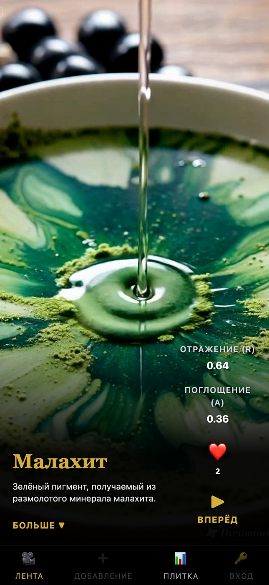

# Исторические пигменты — фронтенд (ЛР5)

Одностраничное приложение на **React + TypeScript + Vite** для каталога исторических пигментов
(тема «Реконструкция первоначального цвета пигмента»). В ЛР5 реализован интерфейс гостя:
лента и плитка пигментов. Если веб-сервис недоступен, данные берутся из коллекции mock-объектов
`PIGMENTS_MOCK` (`src/modules/mock.ts`).

## Навигация

Внизу каждой страницы — панель из 4 пунктов: **Лента**, **Добавление**, **Плитка**, **Вход**.
В ЛР5 доступны только «Лента» и «Плитка». «Добавление» и «Вход» отображаются неактивными:
они появятся в ЛР6 вместе с авторизацией.

## Страницы приложения

### 1. Лента (`/detail/:id`) — доступна



Показывает один пигмент на весь экран.

- **Видео пигмента** на фоне. Если видео нет, показывается изображение пигмента, а без него — изображение по умолчанию `public/assets/images/placeholder.svg`.
- **Название** пигмента.
- **Краткое описание** и кнопка **«БОЛЬШЕ ▼» / «МЕНЬШЕ ▲»**, которая раскрывает и сворачивает полный текст.
- Боковая панель: **отражение (R)**, **поглощение (A)**, **количество лайков**.
- Кнопка **«ВПЕРЁД ▶»** — переход к следующему пигменту.

### 2. Плитка (`/`) — доступна


Каталог пигментов в две колонки.

- **Фильтр поглощения (A ≤ …)** — ползунок от 0,1 до 1,0 с шагом 0,02.
- Кнопка **«ПРИМЕНИТЬ ФИЛЬТР»** — оставляет пигменты с коэффициентом поглощения не больше выбранного.
- **Карточки пигментов**: изображение (или изображение по умолчанию), название, коэффициенты **R | A** и число лайков.
- Нажатие на карточку открывает этот пигмент в ленте.

### 3. Добавление — недоступна в ЛР5 (реализуется в ЛР6)


Добавление пигмента колористом в два шага.

- **Шаг 1:**
  - окна **«Фото»** и **«Видео»** — по нажатию выбирается файл с компьютера, выбранный файл сразу отображается в окне;
  - поле **«Название образца»**;
  - кнопка **«ДАЛЕЕ»** — создаёт черновик пигмента.
- **Шаг 2:**
  - поле **«Краткое описание»**;
  - поля **«Коэф. отражения (R)»** и **«Коэф. поглощения (A)»**;
  - кнопка **«ОПУБЛИКОВАТЬ»** — публикует пигмент и открывает плитку.

### 4. Вход — недоступна в ЛР5 (реализуется в ЛР6)


- Поле **«Логин»**.
- Поле **«Пароль»**.
- Кнопка **«ВОЙТИ»** — вход колориста, после него открывается плитка.
- Ссылка **«Зарегистрироваться»** — регистрация нового колориста.

## Технологии

- React 19, TypeScript, Vite.
- React Router 7 — страницы и навигация (`useParams`, `useNavigate`, `useOutletContext`).
- React-Bootstrap — карточки (`Card`), кнопки (`Button`), индикатор загрузки (`Spinner`).
- Хуки `useState`, `useEffect`.

## Запуск

```bash
npm install
npm run dev      # http://localhost:3000
npm run build    # сборка
```
