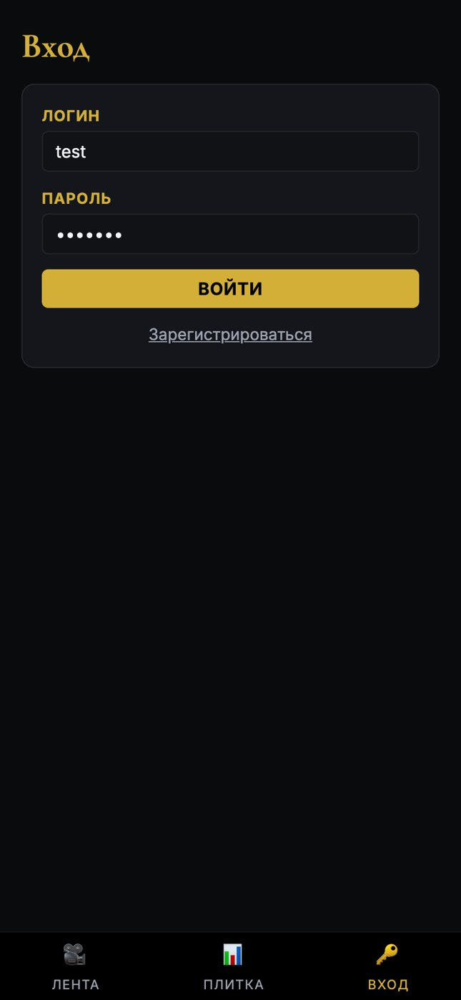

# Исторические пигменты — фронтенд (ЛР7)

Одностраничное приложение на **React + TypeScript + Vite** для каталога исторических пигментов
(тема «Реконструкция первоначального цвета пигмента»). Бэкенд — веб-сервис на Go:
[Phu2885/Historypigments](https://github.com/Phu2885/Historypigments) (ветка `JWT`).

**Демо на GitHub Pages (только mock-данные):** https://phu2885.github.io/BFFHistorypigment/

## ЛР7: адаптивность, PWA, GitHub Pages, HTTPS

- **GitHub Pages.** `npm run deploy` собирает приложение с `mode: "pages"` (`base: /BFFHistorypigment/`,
  `basename` у `BrowserRouter`) и публикует папку `dist` в ветку `gh-pages`. На Pages нет бэкенда,
  поэтому плитка и лента берут данные из mock-коллекции, а вход отключён.
- **PWA.** `vite-plugin-pwa`: манифест (название, иконки 192/512, `display: standalone`) и service worker,
  который кэширует приложение для работы офлайн. Регистрация — `registerSW` в `src/main.tsx`.
- **HTTPS.** `npm run cert` (пакет `mkcert`) создаёт центр сертификации и сертификат для `localhost`
  и IP ноутбука в локальной сети; Vite запускается по HTTPS (`server.https`) и доступен по сети (`host: true`).
  Телефон открывает `https://<IP ноутбука>:3000`, а Vite как обратный прокси передаёт `/api` и `/minio`
  на бэкенд и MinIO ноутбука. Ключи лежат в `certs/` и в git не попадают.
- **Адаптивность** (`src/adaptive.css`). В плитке число колонок не задаётся вручную: CSS Grid
  (`repeat(auto-fill, minmax(...))`) ставит столько колонок, сколько помещается карточек
  минимальной ширины **300px**, но не больше **3**. Карточка растягивается на свободное место (`1fr`),
  поэтому её размер меняется вместе с шириной экрана:

  | Ширина окна | Ширина приложения | Колонок плитки | Ширина карточки |
  |---|---|---|---|
  | 340px | 100% | 1 | 312px |
  | 590px | 100% | 1 | 550px |
  | 768px | 720px | 2 | 330px |
  | 1366px | 1100px | 3 | 337px |

  Лента на экранах от 768px остаётся колонкой 480px по центру (вертикальное видео 9:16),
  страница добавления делится на две колонки: окна фото/видео слева, поля формы справа.

## Что было в ЛР6

- **Redux Toolkit**: фильтр поглощения, плитка, лента, черновик и состояние пользователя.
- **redux-thunk** и клиент на **axios**, сгенерированный из Swagger (`npm run generate-api`), — 7 методов домена пигментов.
- **Вход и выход** — простой axios (`src/modules/authApi.ts`), без кодогенерации и thunk.
- **Mock-данные для гостя.** Если бэкенд недоступен, гость видит коллекцию mock-объектов.
- **Прокси Vite**: `/api` → веб-сервис `:8080`, `/minio` → MinIO `:9000`.

## Навигация

Внизу каждой страницы — панель вкладок **Лента**, **Добавление**, **Плитка**, **Вход**.
«Добавление» видно только колористу, после входа вместо «Вход» показывается **«Выход»**.

## Страницы приложения

### 1. Лента (`/pigments-database-reconstruction`)


Доступна гостю и колористу. Показывает один пигмент на весь экран.

- **Видео пигмента** из MinIO, без него — изображение по умолчанию.
- **Название** и **краткое описание** с кнопкой **«ЕЩЁ ▼» / «МЕНЬШЕ ▲»**.
- **Отражение (R)** и **поглощение (A)**.
- **Лайк** с количеством — ставит или снимает лайк, доступен колористу.
- Кнопка **«ВПЕРЁД ▶»** — следующий пигмент (`next=true`).

### 2. Плитка (`/pigments-database`)


Доступна гостю и колористу. Каталог опубликованных пигментов в две колонки.

- **Фильтр поглощения (A ≤ …)** — ползунок; кнопка **«ПРИМЕНИТЬ ФИЛЬТР»**. Значение фильтра хранится в Redux и сбрасывается при выходе.
- **Карточки**: изображение, название, **R | A**, число лайков. Нажатие на карточку открывает пигмент в ленте.
- Кнопка **«УДАЛИТЬ»** — только на карточках своих пигментов колориста.

### 3. Добавление (`/pigment-database-analysis`)


Доступно колористу. Работает в два шага.

- **Шаг 1:**
  - окна **«Фото»** и **«Видео»** — по нажатию выбирается файл с компьютера, выбранный файл сразу отображается в окне;
  - поле **«Название образца»**;
  - кнопка **«ДАЛЕЕ»** — создаёт черновик, файлы сохраняются в MinIO.
- **Шаг 2:**
  - поле **«Краткое описание»**;
  - поля **«Коэф. отражения (R)»** и **«Коэф. поглощения (A)»**;
  - кнопка **«ОПУБЛИКОВАТЬ»** — публикует пигмент и открывает плитку.

Если черновик уже есть, страница сразу открывается на втором шаге.

### 4. Вход (`/pigments-database-login`)



Доступна гостю.

- Поле **«Логин»**.
- Поле **«Пароль»**.
- Кнопка **«ВОЙТИ»** — JWT сохраняется в `localStorage`, после входа открывается плитка.
- Ссылка **«Зарегистрироваться»** — регистрация нового колориста.

## Запуск

```bash
npm install
npm run cert           # один раз: сертификат для HTTPS (localhost и IP ноутбука)
npm run dev            # https://localhost:3000 и https://<IP ноутбука>:3000, бэкенд на :8080
npm run build:pages    # сборка для GitHub Pages
npm run deploy         # сборка и публикация в ветку gh-pages
npm run generate-api   # пересоздать src/api/Api.ts из Swagger бэкенда
```
