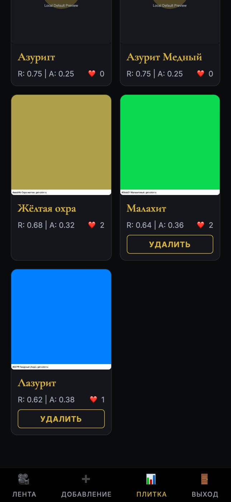
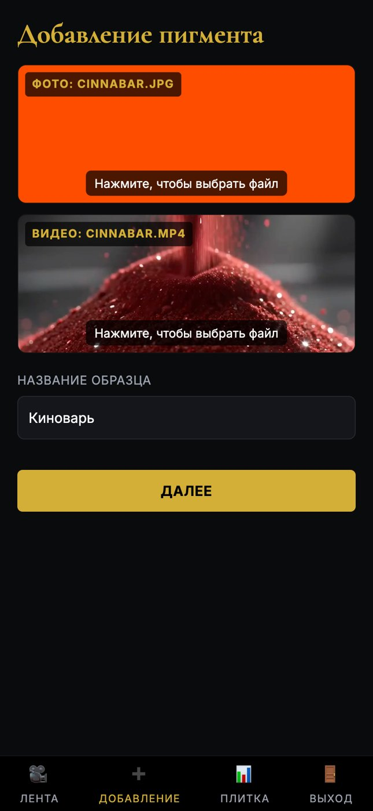

# Исторические пигменты — фронтенд (ЛР6)

Одностраничное приложение на **React + TypeScript + Vite** для каталога исторических пигментов
(тема «Реконструкция первоначального цвета пигмента»). В ЛР6 приложение подключено к веб-сервису
[Phu2885/Historypigments](https://github.com/Phu2885/Historypigments) (ветка `JWT`), добавлены
вход колориста и добавление пигментов.

- **Redux Toolkit**: фильтр поглощения, плитка, лента, черновик и состояние пользователя.
- **redux-thunk** и клиент на **axios**, сгенерированный из Swagger (`npm run generate-api`), — 7 методов домена пигментов.
- **Вход и выход** — простой axios (`src/modules/authApi.ts`), без кодогенерации и thunk.
- **Mock-данные для гостя.** Если бэкенд недоступен, гость видит коллекцию mock-объектов.
- **Прокси Vite**: `/api` → веб-сервис `:8080`, `/minio` → MinIO `:9000`.

## Навигация

Внизу каждой страницы — панель вкладок **Лента**, **Добавление**, **Плитка**, **Вход**.
«Добавление» видно только колористу, после входа вместо «Вход» показывается **«Выход»**.

## Страницы приложения

### 1. Лента (`/pigments-database-reconstruction`)


Доступна гостю и колористу. Показывает один пигмент на весь экран.

- **Видео пигмента** из MinIO, без него — изображение по умолчанию.
- **Название** и **краткое описание** с кнопкой **«ЕЩЁ ▼» / «МЕНЬШЕ ▲»**.
- **Отражение (R)** и **поглощение (A)**.
- **Лайк** с количеством — ставит или снимает лайк, доступен колористу.
- Кнопка **«ВПЕРЁД ▶»** — следующий пигмент (`next=true`).

### 2. Плитка (`/pigments-database`)



Доступна гостю и колористу. Каталог опубликованных пигментов в две колонки.

- **Фильтр поглощения (A ≤ …)** — ползунок; кнопка **«ПРИМЕНИТЬ ФИЛЬТР»**. Значение фильтра хранится в Redux и сбрасывается при выходе.
- **Карточки**: изображение, название, **R | A**, число лайков. Нажатие на карточку открывает пигмент в ленте.
- Кнопка **«УДАЛИТЬ»** — только на карточках своих пигментов колориста.

### 3. Добавление (`/pigment-database-analysis`)



Доступно колористу. Работает в два шага.

- **Шаг 1:**
  - окна **«Фото»** и **«Видео»** — по нажатию выбирается файл с компьютера, выбранный файл сразу отображается в окне;
  - поле **«Название образца»**;
  - кнопка **«ДАЛЕЕ»** — создаёт черновик, файлы сохраняются в MinIO.
- **Шаг 2:**
  - поле **«Краткое описание»**;
  - поля **«Коэф. отражения (R)»** и **«Коэф. поглощения (A)»**;
  - кнопка **«ОПУБЛИКОВАТЬ»** — публикует пигмент и открывает плитку.

Если черновик уже есть, страница сразу открывается на втором шаге.

### 4. Вход (`/pigments-database-login`)


Доступна гостю.

- Поле **«Логин»**.
- Поле **«Пароль»**.
- Кнопка **«ВОЙТИ»** — JWT сохраняется в `localStorage`, после входа открывается плитка.
- Ссылка **«Зарегистрироваться»** — регистрация нового колориста.

## Запуск

```bash
npm install
npm run dev            # http://localhost:3000, бэкенд на :8080
npm run generate-api   # пересоздать src/api/Api.ts из Swagger бэкенда
npm run build
```
